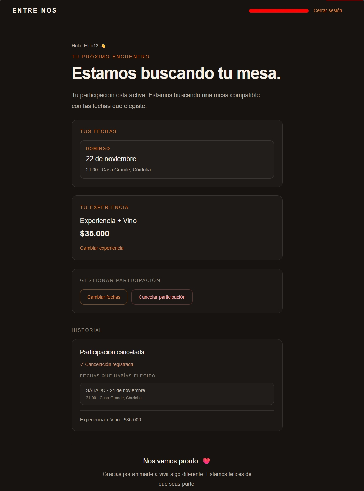
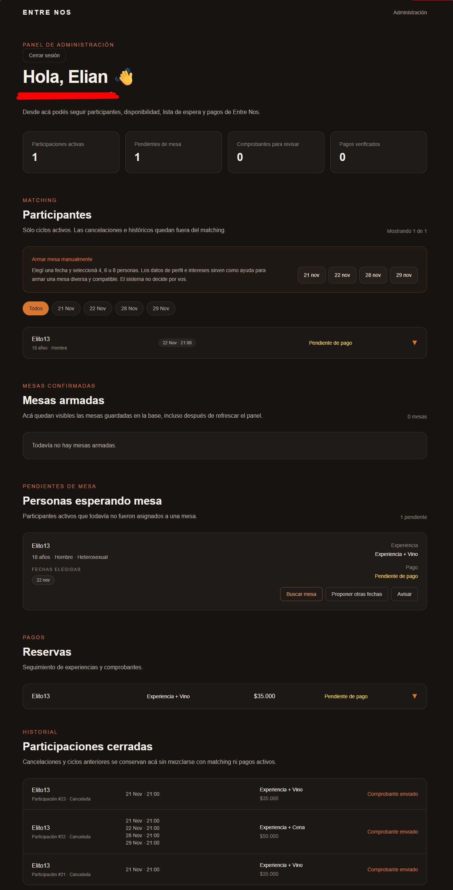

# Entre Nos — Full-Stack Web Application

### A real-world project built with Next.js, React, TypeScript and PostgreSQL

🌐 **[Live Website](https://entrenoscordoba.com.ar)**


## Application Screenshots

### Landing Page


### Registration Experience


### Application Interface


## About the Project

Entre Nos is a full-stack web application designed to connect people through curated social dining experiences in Córdoba, Argentina.

The platform allows participants to register, share their preferences, and join organized social events.

This project demonstrates practical experience in full-stack development, database integration, authentication, API development, and production deployment.

## Technology Stack

**Frontend**
- Next.js (App Router)
- React and TypeScript
- Tailwind CSS

**Backend & Database**
- Next.js API Routes
- PostgreSQL
- Neon Database
- Drizzle ORM
- Neon Auth

**Integrations & Deployment**
- Resend (transactional email)
- Vercel (hosting and deployment)
- Git and GitHub (version control)

## Key Features

### User Registration
- Multi-step registration workflow
- Form validation
- User authentication
- Collection of participant preferences

### Event Management
- Event date management
- Participant registration
- Administrative event management

### Administrative Dashboard
- Protected administrative functionality
- Event and participant management
- Notification campaign preparation

### Email Notifications
- Transactional email integration
- Server-side email notification workflows

## Architecture Overview

```text
                 USERS
                   |
                   v
          Next.js / React UI
                   |
                   v
         Next.js API Routes
                   |
          +--------+--------+
          |        |        |
          v        v        v
       Neon     Neon Auth  Resend
     PostgreSQL             Email
          |
          v
     Application Data

Deployment: Vercel
Version Control: GitHub
```

## Technical Challenges

- Implementing secure user authentication
- Integrating PostgreSQL with server-side application logic
- Validating multi-step registration forms
- Protecting administrative API endpoints
- Troubleshooting deployment and rendering issues
- Managing application updates and production deployments

## Current Development

WhatsApp notification automation is being developed as an additional communication channel.

## Live Demo

Visit the deployed application:

https://entrenoscordoba.com.ar

## Source Code

The production source code is maintained in a private repository.

This public repository documents the application's architecture, features, and technical implementation.

## Developer

**Elian Muller**

Product Support Engineer | Linux | Email Security | Full-Stack Development

GitHub: https://github.com/elimuller89
